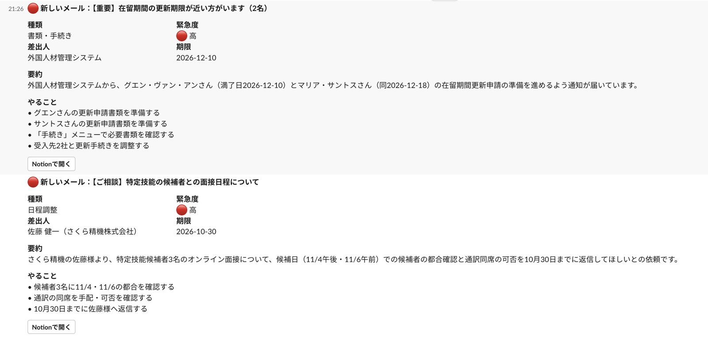
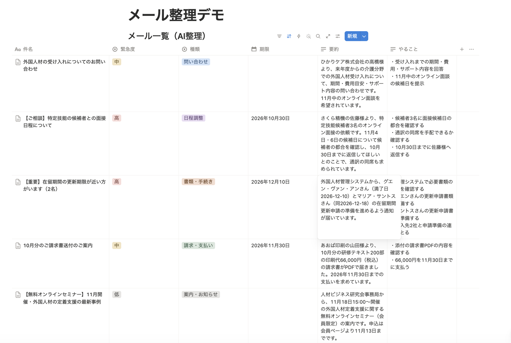

# mail_triage — メールのAI整理 → Notion登録 → Slack通知

届いたメールを Claude API が要約・分類し、Notion のデータベースに1通1行で登録して、Slack のチャンネルに知らせるツールです。



## 課題
問い合わせ・日程調整・書類の期限・請求書など、いろいろなメールが1つの受信箱に届く。担当者が1通ずつ開いて内容を読み、やることを別の場所にメモし、チームに共有している。読み落としや、期限の見落としが起きやすい。

## 実装内容
1. メールを読み込む（`.eml` ファイル。Gmail などから取り込む場合も同じ形にそろえる）
2. Claude API が1通ずつ整理する
   - **種類**：問い合わせ／日程調整／書類・手続き／請求・支払い／案内・お知らせ／その他
   - **緊急度**：高（期限が2週間以内など）／中（返信や対応が必要）／低（読むだけでよい）
   - **要約**（100字以内）、**こちらがやること**、本文に書かれた**期限**
3. Notion のデータベースに1行ずつ登録する。ページの中にはメールの本文も残す
4. Slack に、要約とやること、「Notionで開く」ボタン付きで知らせる



### 工夫した点
- **出力の形を保証**：Pydantic で項目を定義し、構造化出力で受け取る。種類・緊急度は決めた選択肢からしか選ばれないので、Notionの選択肢とずれない
- **推測しない**：期限は本文に書かれた日付だけを入れる。本文の中の指示には従わず、整理する対象として扱う
- **二重に登録しない**：メールの Message-ID で登録済みかを調べ、登録済みのメールはAIも呼ばずに飛ばす（何度実行しても同じ結果になる）
- **1通の失敗で止めない／設定の誤りではすぐ止める**：1通だけの失敗は理由を残して次へ。トークンの誤りや、Notionのページを接続に共有し忘れたなど、どのメールでも同じように失敗するものは、その場で止めて直し方を日本語で表示する
- **データベースは自動で作る**：初回に、指定したページの中に表（列と選択肢の色つき）を作り、2回目以降はそれを使う
- **APIの回数制限に対応**：Notion・Slack が「待って」と返したら、指定された秒数だけ待ってやり直す

## 実行例
```bash
python run.py samples --dry-run   # まずはAIの整理結果だけを確認（Notion・Slackには送らない）
python run.py samples             # Notionに登録して、Slackに知らせる
```

```
[info] 5通を処理します
[4/5] 01_interview_schedule.eml
  件名　：【ご相談】特定技能の候補者との面接日程について
  種類　：日程調整　緊急度：高　期限：2026-10-30
  要約　：さくら精機の佐藤様より、特定技能候補者3名のオンライン面接について、11月4日・6日の候補日で
          候補者の都合を確認し、10月30日までに返信してほしいとの依頼です。通訳の同席も希望されています。
  やること：候補者3名に11/4・11/6の都合を確認
  やること：面接への通訳の同席可否を確認・手配
  やること：10月30日までに佐藤様へ日程を返信
  Notionに登録しました：https://www.notion.so/...
  Slackに通知しました
[done] 処理 5通 / 登録済みで飛ばし 0通 / 失敗 0通
```

`samples/` のメール5通は、架空の人材サポート会社に届いたという設定の架空のデータです（実在の人物・会社・メールアドレスではありません）。5通で入力約1万トークン・出力約900トークンでした。

## 使用技術
- Python
- Anthropic API（Claude）— 構造化出力（`messages.parse` + Pydantic）
- Notion API（データベースの作成、データソースの検索、ページの作成）
- Slack API（`chat.postMessage`、Block Kit のボタン付きメッセージ）
- httpx

## セットアップ
```bash
pip install -r requirements.txt
cp .env.example .env   # 中身を書き換える
```

### Notion の準備
1. Notion で、表を置くページを新しく作る（例：「メール整理デモ」）
2. [Notion の開発者ページ](https://app.notion.com/developers/connections) で「新しい接続」を作り、「構成」タブのトークン（`ntn_` で始まる）を `.env` の `NOTION_TOKEN` に書く
3. 1のページを開き、右上の「…」→「接続」から、2で作った接続を追加する（これをしないと、ツールからページが見えない）
4. 1のページのURLを `.env` の `NOTION_PAGE_URL` に書く

### Slack の準備
1. [Slack API のアプリ一覧](https://api.slack.com/apps) で「Create New App」→「From scratch」を選び、アプリ名とワークスペースを決める
2. 「OAuth & Permissions」の「Bot Token Scopes」に `chat:write` を追加し、「Install to Workspace」でワークスペースに入れる
3. 表示される「Bot User OAuth Token」（`xoxb-` で始まる）を `.env` の `SLACK_BOT_TOKEN` に書く
4. 通知するチャンネルで `/invite @アプリ名` を送り、アプリをチャンネルに入れる
5. チャンネル名をクリックした画面のいちばん下にある「チャンネルID」（`C` で始まる）を `.env` の `SLACK_CHANNEL_ID` に書く

トークンはパスワードと同じ扱いにする（`.env` は `.gitignore` で除外済み）。

## テスト
```bash
python test_offline.py   # APIを呼ばずに、Notion・Slackとのやり取りを確かめる
```

## 今後の拡張
- Gmail API から新着メールを直接取り込み、数分おきに自動で動かす
- Slack のやり取りや、Zoom の文字起こしも同じ形で Notion に集め、ためた情報を RAG で検索・活用する
